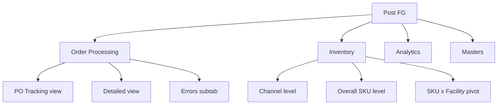
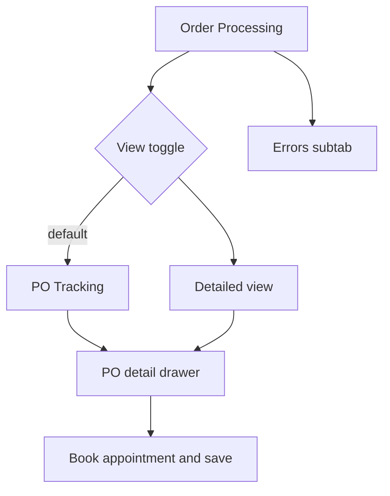
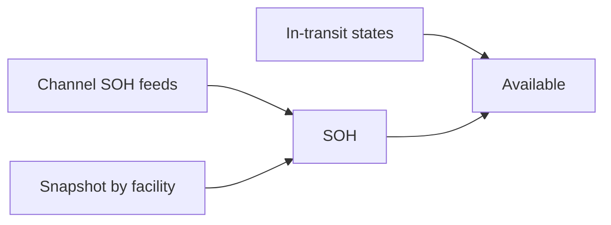
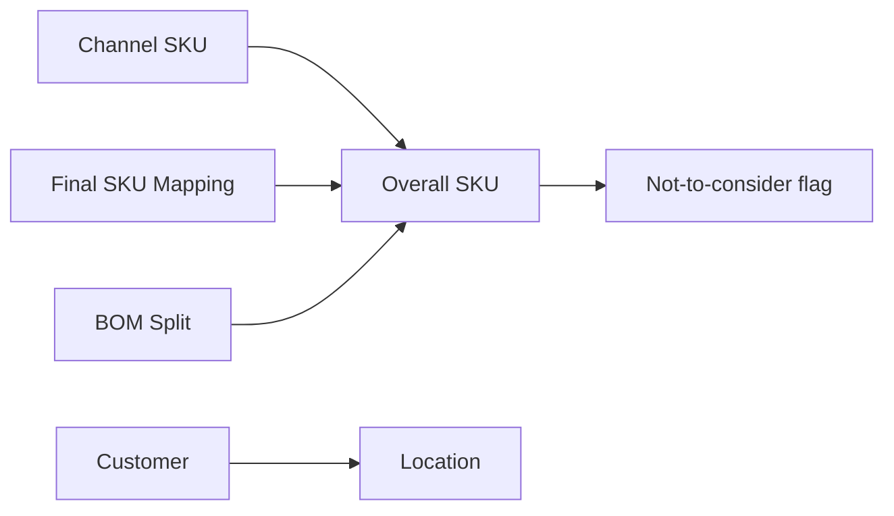
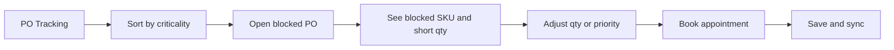
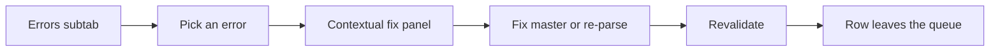
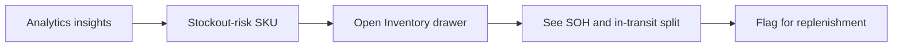
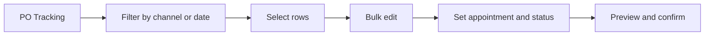

# Post FG ERP — Design & UI Spec

2026-09-22 · @aadya

Design and UI spec for the Post FG interface: one light-themed app consistent with PreFG, across four modules — Order Processing, Inventory, Analytics and Masters — with screen layouts, component specs, states and user flows for the Figma build. Companion to the Post FG PRD.

## Foundations & navigation

One light theme across Post FG, consistent with PreFG: serif page titles, clean neutral surfaces, a single indigo accent, and mono for all IDs and codes. Reuse two patterns you already have — the PreFG master screen (serif title, pill toggle, search, filter, table) and the Uniware contextual drawer — so this reads as the same product family rather than a new app.

### Information architecture

Four top-level modules. Order Processing carries a view toggle and an Errors subtab; Inventory carries three views.



Masters and Analytics are single destinations; Order Processing and Inventory switch views in place without leaving the module.

### Layout shell

- Left nav rail (collapsible, \~240px): the four module items with icons, active item in indigo. Collapses to icon-only.
- Top bar: page title area, global search, brand context (mCaffeine / Hyphen / All), user menu.
- Content area: max-width \~1440px, 24px gutters, 12-column grid. Data grids may exceed content width and scroll horizontally inside their own container.

### Type scale

| Role | Font | Size / weight |
| --- | --- | --- |
| Page title | Serif display (e.g. Source Serif 4) | 28 / 500 |
| Section title | Sans | 18 / 600 |
| Card label | Sans | 13 / 500, uppercase, letter-spaced |
| Body | Sans (Inter) | 14 / 400 |
| Table cell | Sans | 13 / 400 |
| Caption / hint | Sans | 12 / 400, muted |
| IDs, SKU & PO codes | Mono | 13 / 400 |

### Colour tokens

| Token | Hex | Use |
| --- | --- | --- |
| accent / accent-bg | #4F46E5 / #EEF2FF | primary buttons, links, active tab/nav |
| bg / surface / surface-alt | #FFFFFF / #F9FAFB / #F3F4F6 | page, cards, headers |
| border | #E5E7EB | hairlines, dividers |
| text / text-secondary / text-muted | #111827 / #6B7280 / #9CA3AF | primary / labels / hints |
| danger | #DC2626 / #FEF2F2 | critical, error, blocked |
| warning | #D97706 / #FFFBEB | expiry soon, at-risk aging |
| success | #16A34A / #F0FDF4 | healthy, booked, high fill |
| info | #2563EB / #EFF6FF | neutral badges |

Radius: 8px controls, 12px cards. Spacing scale: 4 / 8 / 12 / 16 / 24 / 32. Money is Indian-grouped with the rupee sign (₹8,12,400); dates are YYYY-MM-DD.

### Status colour system

| Family | Values → colour |
| --- | --- |
| Criticality | Critical → danger · High → warning · Normal → neutral |
| Source | API → indigo · Excel → success · OCR → warning |
| Appointment | Booked → success · Not booked → warning · Rejected → danger |
| Inventory-blocked | blocked → danger pill with the short SKU |
| Aging (days of cover) | at-risk → danger · watch → warning · healthy → success |

### Reusable components

Every screen is assembled from a small kit — build these as Figma components with the variants noted:

1. Data grid — sticky header, checkbox selection column, column show/hide, density toggle, horizontal scroll, hover row, sticky first (PO/SKU) and last (Action/Status) columns, top and bottom pagination with a page-size selector. States: loading (skeleton rows), empty, error.
2. Filter bar — labelled fields in a responsive grid: date-range pairs, multi-selects with removable chips, text inputs; a Clear All, a record count, and a right-aligned action cluster (Export CSV, Bulk Upload / Bulk SKU Update).
3. Pill toggle (segmented) — the Material Master pattern; two or three options, active filled indigo.
4. Subtabs — workflow tabs with count badges (All, Intake, In-flight, Delivered/GRN, Errors).
5. Metric card — uppercase label, large value, unit, small footnote, optional status dot.
6. Status badge — variants per the status system above.
7. Contextual drawer (right, \~520px) and modal — for PO detail and record edit; header, meta grid, editable section, line-items table, sticky footer (Close / Save changes).
8. Bulk action bar — appears on row selection: selected count, the bulk actions, Cancel.
9. Toast + confirm dialog — for saves and destructive/irreversible actions.

### Global notes

- Roles & permissions: *placeholder — RBAC to be defined later (PreFG has three roles; Post FG roles TBD).*
- Soft deletes and an append-only audit trail, matching PreFG.

## Order Processing

One module. A pill toggle switches between the smart PO Tracking view (default) and the Detailed view (the Pep IMS-style flat grid); an Errors subtab surfaces failed cross-checks with resolve actions. Selection-based bulk edit and CSV bulk upload run across both views.



### Page frame (shared)

- Header: serif title “Order Processing”; subtitle showing the pipeline — Intake → validate → COPT → sale order → dispatch → GRN · tracked at PO level, criticality drives what to work on next. Right actions: Download CSV, Bulk Upload.
- Pill toggle: PO Tracking | Detailed view.
- KPI card row (four): Critical POs (count, “work first”), Inventory-blocked (count, “short stock”), Avg Fill Rate (%, “shipped ÷ ordered”), PO → Delivery (avg days, “target < 12”).
- Subtabs with counts: All POs · Intake · In-flight · Delivered / GRN · Errors (danger-styled with count).
- Toolbar: Columns · Filters · Density · Export · Bulk Upload; a “Filter by PO number or channel” search.

### View 1 · PO Tracking (PO level, default)

One row per PO. Columns:

| Column | Notes |
| --- | --- |
| ☐ select | drives bulk edit |
| PO Number | mono, links to detail drawer |
| Channel / Brand | channel bold + B2B/B2C tag, brand beneath |
| Facility | e.g. GGN\_WAREHOUSE |
| Source | badge: API / Excel / OCR |
| Criticality | badge (Critical / High / Normal) + “blocked” tag when short |
| Units | ordered units |
| Fill | % |
| Expiry | days to PO expiry, colour by urgency |
| Appointment | Booked / Not booked / Rejected |

Criticality is computed (per the PRD): days to expiry + appointment date / location TAT + channel priority (editable) + SKU priority (editable) + inventory-block. By default the system allocates available inventory across open POs by priority to flag which would be blocked; blocked rows show a danger tag. Row click opens the PO detail drawer.

### PO detail drawer

Opens from either view. Structure (from your mockup):

- Header: PO number (mono) + meta line — channel · B2B · brand · via {source} · facility. Close (×).
- Badge row: Criticality · score · stage (e.g. COPT Verify) · blocked · {SKU}.
- Meta grid (read-only): Entry Date, PO Date, Location, Working Date, Dispatch Date, Units ordered, PO value (₹), Days to expiry.
- Appointment block (editable): current appointment date (date picker), reason for change (text).
- SKU lines table: SR, SKU Name, SKU Code (mono), Channel SKU, Qty, Updated Qty (editable, highlighted when changed), Wt (kg), Planning status, Warehouse status.
- Sticky footer: Close · Save changes (primary).

Editable in the drawer: appointment date + reason, Updated Qty per line, and the line statuses. Saving pushes changes and re-syncs status from Uniware.

### View 2 · Detailed view (Pep IMS-style flat grid)

One row per PO SKU line. 100 rows per page by default, changeable via a page-size selector (100 / 200 / 500). Pagination top and bottom.

Header actions: record count (“N of M Records”), Export CSV, Bulk SKU Update. Search: by PO Number or Shipment UID.

Filters (exact set): PO Date From, PO Date To, Working Date From, Working Date To, Brand, Channel, Facility, Location, SKU Code, Status Planning, Status Warehouse, Status Logistics, Final Status, Clear All.

Columns (exact, in order): Shipment UID · Entry Date · Brand · Channel · Location · PO Date · PO Number · Sr No · SKU Name · SKU Code · Channel SKU Code · Quantity · GMV · PO Value · Updated Quantity · Updated GMV · Updated PO Value · Facility · Action · Status.

- Action (···): row menu — view PO detail, open in tracking, edit SKU line.
- Status: Final Status indicator (coloured dot/pill + tooltip with the status name).

### Errors subtab

Surfaces cross-check failures so the team validates by exception instead of row-by-row. Cross-check fields: Qty, location, PO no., PO value, SKU.

| Error type | Resolve action |
| --- | --- |
| Wrong margin / MRP | open line, correct against channel master |
| Customer not found | add customer to master, reprocess |
| SKU not found | add channel-SKU mapping, reprocess |
| Reading / processing issue (pincode) | re-parse or manual entry |
| Same location, multiple WH | choose WH, review |
| File not readable | request resend / manual entry |

Layout: a grid of failing rows — Shipment UID / PO, Channel, SKU, Error type (badge), Detail, Detected at, Action (Resolve). Clicking Resolve opens a contextual panel with the specific fix; on success the row revalidates and leaves the queue. Where a fix is shared (e.g. one missing SKU mapping affecting many rows), offer bulk resolve.

### Bulk edit & bulk upload

- Bulk edit (in-table): select rows → the bulk action bar appears → Bulk edit → set any of appointment date, appointment status, internal status, and final status for all selected, with per-row override in a preview step → confirm → Save.
- Internal & final status values: *placeholder — appointment statuses and the internal set (RTS / On Hold / Shipped) to be finalised with the team; wire the control now, populate options on sign-off.*
- Bulk upload (CSV): download template → upload → validation preview with errors flagged → commit. “Bulk SKU Update” on the Detailed view is the same flow scoped to SKU-line fields.

## Inventory

The live inventory picture for the DP team. Three views under one module: Channel level, Overall SKU level, and a SKU × Facility pivot. V1 covers B2C + D2C. *Placeholder — B2B inventory deferred to a later version; channel-level SOH is available.*

Available is built from stock on hand plus in-transit; DRR, days-of-cover (aging) and a week-over-week delta signal ride alongside as columns in both grid tabs.

```latex
Days\ of\ cover = \frac{SOH}{DRR}
```

DRR window: *placeholder — rolling window (e.g. trailing 7 or 28 days) to confirm.* The delta signal flags any SKU whose DRR moved more than 5% versus last week. A snapshot selector switches between the Monday / month-end frozen snapshot and the real-time view.

### Aging colour-coding (shared rule)

The aging (days-of-cover) cell is colour-coded to surface high-DRR, low-stock SKUs that may run out:

| Band | Colour | Meaning |
| --- | --- | --- |
| At-risk | danger | low cover against a high or rising DRR — likely stockout |
| Watch | warning | tightening cover |
| Healthy | success | comfortable cover |

Thresholds: *placeholder — e.g. < 7d at-risk, 7–21d watch, > 21d healthy; confirm with DP.*

### Tab 1 · Channel level

Grid keyed SKU × channel × location.

| Column | Notes |
| --- | --- |
| SKU Code | mono |
| SKU Name |  |
| Channel |  |
| Location / Facility |  |
| SOH | stock on hand |
| In-transit | total; drawer breaks it down by state |
| Available | SOH + in-transit (*committed/blocked handling — placeholder, confirm*) |
| DRR | daily run rate |
| Days of cover | aging, colour-coded per the rule above |
| Δ WoW | delta signal chip when > 5% |

Filters: brand, channel, location/facility, SKU, and a “signals only” toggle. Row click opens a drawer: SOH broken down by feed, in-transit broken down by state (Working, Manual Check, RTS, Intransit, Working Hold), and a small DRR trend.

### Tab 2 · Overall SKU level

SKU aggregated across channels and locations.

| Column | Notes |
| --- | --- |
| SKU Code / SKU Name | mono code |
| Total SOH |  |
| Total In-transit |  |
| Available |  |
| DRR |  |
| Aging | days of cover, colour-coded |
| Δ WoW | signal chip when > 5% |

Row click drills to the per-channel / per-location split (i.e. the Channel-level rows for that SKU).

### View · SKU × Facility pivot

A separate pivot view: rows = SKU, columns = warehouse / facility, cells = units, colour-coded. A metric switch changes the cell value between SOH, In-transit and Available. This is the lighter-weight read of stock spread across facilities; a full colour-coded coverage matrix is a possible later evolution *(noted for discussion — flagged as potentially clunky at scale).*

### In-transit composition

What feeds Available, for reference (full logic in the PRD):



Only Working, Manual Check, RTS, Intransit and Working Hold count as in-transit; Working Hold is currently DP-only — *placeholder, confirm whether it counts as available here.*

## Masters

All masters under one module, using the PreFG master screen pattern so it feels identical to Material Master: serif title, subtitle, an optional pill toggle for sub-types, a search, a Filters control, and a managed table with Add / Edit and bulk upload. Masters sync from Uniware (the primary source) and Post FG holds a clean copy; each screen shows a last-synced indicator and a Sync now action.

### Masters included

| Master | Sub-type toggle | Key columns |
| --- | --- | --- |
| Overall SKU master | Brand (mCaffeine / Hyphen) | SKU Code, SKU Name, Brand, Type, MRP, Weight, Status |
| Channel SKU master | Channel | Channel, Channel SKU, Internal SKU, Mapping status |
| Channel / Customer master | — | Channel, Customer code, Name, Location, Facility, Consignee |
| Location / Facility master | — | Facility, Final Location, Region (GGN / Mumbai), Channel |
| Vendor ↔ Channel-SKU mapping | — | Vendor, Channel SKU, Internal SKU |
| Final SKU Mapping | — | Listing SKU, Final SKU |
| BOM / Split master | Split1 / Split2 | Parent SKU, Component SKU, Qty per parent |
| SKU-Not-To-Consider | — | SKU, Reason, Consider? (No) |

### Standard master screen

- Header: serif title + one-line subtitle (e.g. “All raw and packing material master records” style).
- Pill toggle where a master has sub-types (Brand, Channel, or Split1/Split2).
- Search by code / name; Filters control alongside.
- Table: the master’s columns, inline edit or a row edit drawer, row actions (edit, soft-delete), and a Consider?/Status chip where relevant.
- Actions: Add new (drawer form), Bulk upload (CSV template → validate → commit), Export.
- Every change is soft-delete + append-only audit, matching PreFG.

### Data-hygiene features

These come straight from the intransit pipeline’s known pain points and should be first-class in the master screens:

- Mapping-gap surfacing: for Channel SKU, Final SKU Mapping and BOM, a “gaps” view lists codes with no downstream mapping, ranked by units, so the biggest are closed first.
- Case-insensitive codes with a single canonical casing on save (prevents duplicate rows for the same SKU).
- New customer in Uniware → prompt to add it to Post FG with location, facility name and consignee.
- Purplle channel code changes on every edit — handle re-mapping rather than treating each as a new code.
- Dedupe helpers on load, matching how the raw data is reconciled today.

### Master relationships



Channel SKUs, the final-SKU mapping and BOM components all resolve to the overall SKU; customers carry a location; the exclusion flag sits on the SKU.

## Analytics

A single dashboard, not a set of screens. Global controls at the top: date range, brand, channel. Below, KPI cards, then the fill-rate and PO-to-delivery blocks, then an insights strip that lists only the SKUs carrying a signal.

### KPI cards

A row of metric cards: Avg Fill Rate (%), PO → Delivery (avg days, target < 12), Critical POs, Inventory-blocked POs, and SKUs flagged (count of signal SKUs).

### Fill rate

A view switch drives one chart + a drillable table beneath it, at the level chosen: SKU / PO / channel / continued vs discontinued SKUs. Fill rate is shipped ÷ ordered. Default chart: fill rate by channel (bar), with continued vs discontinued shown as a grouped split when that level is picked.

### PO-to-delivery

Average PO-to-delivery days, viewable overall and by channel — a bar per channel against a target line at 12 days, so channels running long (12–13 days) stand out. A drill table lists the slowest POs.

### Insights (signals only)

The analytics dashboard shows only the SKUs that carry a signal, as actionable insights rather than a full table:

- Stockout risk: high or rising DRR against low days-of-cover (the at-risk aging band).
- DRR moved > 5% week-over-week.

Each insight is a compact card / row — SKU, the signal, current SOH, DRR, days of cover — with a link into the Inventory drawer for that SKU. This keeps the dashboard focused on what needs action, while the full numbers live in the Inventory module.

*Chart types above are the intended visualisations; exact series and thresholds follow the Inventory placeholders.*

## Key user flows

The four flows the interface has to make fast.

### Work a critical, blocked PO



The team lands on Tracking, works top-down by criticality, opens a blocked PO, resolves the shortfall or reprioritises, books the appointment, and saves.

### Resolve an intake error



Errors are worked by exception: pick one, apply the specific fix (add a mapping, add a customer, re-parse), revalidate, and it clears — with bulk resolve when one fix covers many rows.

### Act on a stockout signal



The dashboard shows only signal SKUs; from an insight the user jumps into the Inventory drawer to see the SOH and in-transit breakdown. *Replenishment execution is a later version; V1 surfaces and flags.*

### Bulk reschedule appointments



Filter to the affected POs, select, bulk-edit the appointment date and status, review the preview, confirm.

### Open items carried from the PRD

- Appointment / internal / final status values to finalise with the team.
- Aging thresholds and DRR window to confirm with DP.
- Available = committed vs blocked handling, and Working Hold treatment.
- Roles & permissions model.
