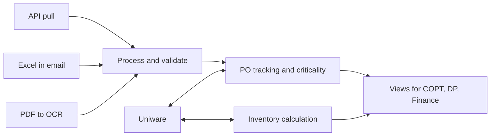
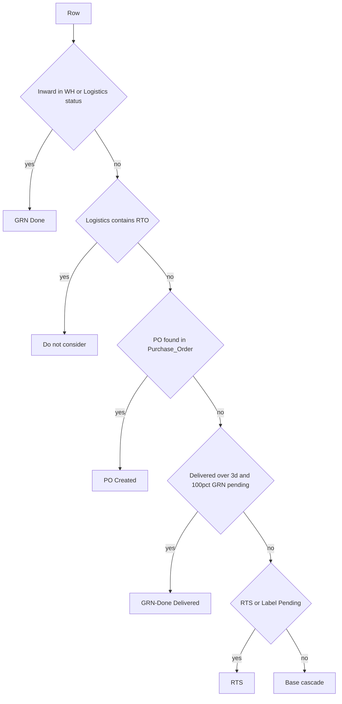
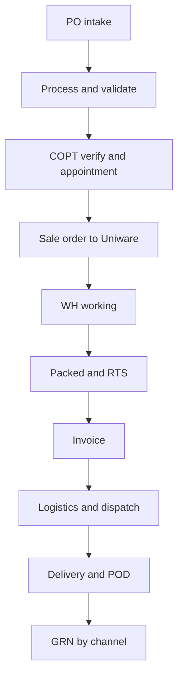
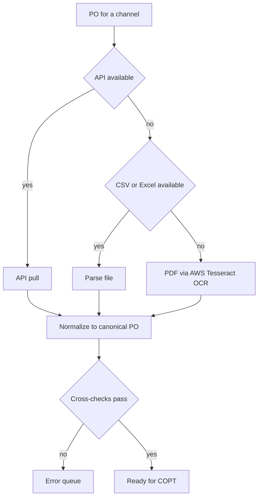

# Post FG ERP — Order Processing & Inventory (PRD)

2026-09-22 · @aadya

Post FG is the downstream sibling to PreFG: it takes over PO intake, processing and tracking — replacing Stashflow and Pep IMS — and gives the Demand Planning team a live inventory picture, all wrapped around Unicommerce via API. It ships in three versions: V1 stands the system up, V2 adds operational depth, V3 makes it predictive.

## Overview, scope & shared architecture

Post FG replaces two tools and wraps a third. Stashflow (OCR-based PO processing, and only for some POs) and Pep IMS (PO and shipment tracking) collapse into one system; Unicommerce (Uniware) stays the system of record, and Post FG reads and writes to it through its API and export-job API rather than the CSV import/export used today. The result is one place that ingests a PO, validates it, pushes the sale order to Uniware, tracks it to delivery, and — alongside — computes live inventory for the Demand Planning (DP) team.

The module has two subsections over one shared backbone (SKU × channel × location × status): Order Processing & PO Tracking, and Current Inventory Calculation. They reinforce each other — because inventory is computed in the same system, the order side can flag POs that would be blocked by short stock.

### Channels in scope

- B2B (Post FG receives POs as a vendor): \~10–11 channels — Blinkit, Swiggy, Zepto, Nykaa, Purplle, Firstcry, BigBasket, Tata 1mg, RK/QCom and similar.
- B2C (marketplace seller): 3 — Amazon, Flipkart, Myntra.
- D2C: own website (mCaffeine, Hyphen).
- Inventory in V1 covers B2C + D2C only. B2B inventory is deferred to V3; channel-level SOH is already available.

### System of record

Uniware owns sale orders, warehouse/shipment status, invoices and inventory movement. Post FG owns intake, validation, PO criticality, the tracking UI, inventory computation and a synced cache of masters. Post FG never bypasses Uniware — it wraps it.

### Masters & sync

Masters are mixed-source today, but Uniware is primary, so Post FG can sync from Uniware and holds a clean copy. Additionally, it can also be collated from current existing masters.

&#32;Masters needed:&#32;

1. overall SKU master,
2. channel SKU master
3. channel/customer master
4. location master
5. &#32;channel-SKU mapping\
\
Known data-quality issues to design around: Uniware SKU codes needs a cleanup.\
A new customer can be added via our system which will be passed to Uniware via API along with its location, facility name and consignee\
Also, Purplle's channel code changes on every edit; and marketplace channel SKUs must be resolved to internal SKUs through a mapping.

### How it fits together



Post FG sits between the channels and Uniware: it ingests and validates POs, syncs sale orders and status with Uniware, computes inventory, and serves both to the operating teams.

### **Glossary**

COPT — team that owns correct PO processing (Ankit M's team)\
DP — Demand Planning (Sadaqat, Vivek & Shubham); \
Uniware or  Unicommerce OMS/WMS; \
SOH — stock on hand; \
DRR — daily run rate (sales velocity); \
RTS — ready to ship; \
POD — proof of delivery; \
GRN — goods receipt note; \
ASN — advance shipment notice; \
MWH / CWH — mother/ channel warehouse; \
FR — fill rate.

### Build sequence

V1 starts with inventory because it is partly built: Amazon's pipeline is done, Flipkart lands this week, Myntra needs an RPA feed, and collation code already exists — stitching these is \~10–12 days. Order processing follows, \~1 month.

## Version 1 — Stand up the system

V1 is the working system: inventory computed live, POs ingested and validated, sale orders pushed to Uniware, and every PO trackable in one place with a criticality signal that tells the team what to work on. No suggestions or predictions yet — those are V2 and V3. Build inventory first (it is partly done), then order processing.

### Module 1 · Current Inventory Calculation

A live inventory picture the DP team uses to decide what to make, move and prioritise. It has two halves: current stock on hand (SOH), collated from channel and Uniware reports, and in-transit stock, computed with the existing intransit pipeline logic. V1 productises the pipeline that runs today as a manual Excel job.

**SOH sources and Final Units.** Each feed maps to a channel and a Final Units formula:

| Feed | Channel | Type | Final Units |
| --- | --- | --- | --- |
| FK\_SOH | Flipkart | B2C | Live on Website |
| Amazon\_SOH | Amazon | B2C | Ending Warehouse Balance |
| Myntra\_SOH | Myntra | B2C | inventory count (only rows where po\_type = SJIT) |
| Snapshot — D2C | D2C | D2C | Inventory + Putaway Pending + Open Purchase (+ Stock In Transfer for mCaff\_Gurgaon3 / mCaff\_Mumbai2) − Open Sale |
| Snapshot — DarkStore | DarkStore | DarkStore | Inventory + Putaway Pending + Open Purchase + Stock In Transfer − Open Sale |
| Snapshot — GGNMWH / MUMMWH | MWH | MWH | Inventory + Putaway Pending + Open Purchase + Stock In Transfer |
| Snapshot — Return | Return | Return | Inventory + Putaway Pending + Open Purchase + Stock In Transfer |

Each snapshot group is limited to its own explicit facility list (D2C spans \~21 facilities incl. HYP\_SRGGN, mCaff\_Mumbai2, mCaff\_Gurgaon3; GGNMWH = GGN\_WAREHOUSE + HYP\_B2B\_GGN; MUMMWH = HYP\_B2B\_MUM2 + MUM\_WAREHOUSE2; Return = Return\_MUM2 + Return\_GGN). Final Location comes from the Location Master (Facility + Channel → Fulfilment Centre-ID + Channel), with explicit facility overrides taking priority and a fallback to the facility value when unmapped.

**In-transit stock — Final Status derivation.** Each shipment/PO row is assigned a Final Status by a priority cascade (top rule wins):



The base cascade resolves to Working, Manual Check, Intransit or Working Hold. Only these four plus RTS count as in-transit stock; PO Created, GRN Done and the GRN-Done(Delivered) variants are excluded from the intransit total. Working Hold is currently considered only for the DP team — confirm whether it should count as available (see open items).

**In-transit unit formulas:**

| Row source | final Intransit units | Final Planning units |
| --- | --- | --- |
| Export-B2B, Sale Order = COMPLETE | Complete Qty | Total Qty − Cancelled Qty |
| Export-B2B, otherwise | Allocated + In Process + Complete | Total Qty − Cancelled Qty |
| PO not found in Export-B2B | Updated Qty | Updated Qty |
| Purchase\_Order status = CREATED | Order Qty (Final Status = PO Created) | Order Qty |

**Combined view and SKU resolution.** SOH and in-transit merge into one Combined SOH+Intransit view keyed on a Final SKU Code, resolved by matching the row's SKU Code against Final SKU Mapping (Listing\_SKU → Final SKU), case-insensitive, falling back to SKU Code when unmapped. Combo SKUs explode through bill-of-materials files (Split1/Split2): each component receives the full parent unit count (100 combos → 100 of each component), and unmapped SKUs pass through unchanged so no units are lost. A Consider? flag (from the non-saleable exclusion list — packaging, tapes, tool boxes) marks rows to exclude by filter rather than deletion, so totals still reconcile.

**Snapshot cadence.** Monday and month-end are frozen snapshots; the rest is real-time. The service keeps a snapshot table for those two cadences and a live view otherwise.

**DRR & aging.** For each SKU, compute DRR (daily run rate) and aging = SOH ÷ DRR (days of cover). Raise a signal when DRR moves more than 5% week-over-week. Example: an SKU with 15,000 units and a DRR of 500/day has 30 days of cover; if last week's DRR was 460, this week's +8.7% trips the signal.

**Views and output.** Channel × SKU × location, with a DP working view (working date · available inventory · short inventory) and an option to prioritise when short. Delivered as in-app views plus an Excel export (DP already works from Excel).

**Data-integrity rules (hard requirements for the productised pipeline).** These are real failures seen in the current Excel build and must be handled in code: 13+ digit PO numbers must stay Text or they collapse to scientific notation (dozens of distinct POs merging into one truncated value — unrecoverable after the fact); strip leading backtick/apostrophe on all match keys before comparing; match SKUs case-insensitively and emit a canonical casing; fall back to cp1252 on non-UTF-8 characters; and surface mapping gaps ranked by units so the largest are closed first.

**Productisation note.** Today this is a \~10-stage manual Excel pipeline (stage1 → stageG2) producing an .xlsx. V1 keeps the same logic but runs it as a scheduled service reading Uniware export-job/API plus the channel feeds, serving live views, writing the Monday/month-end snapshot, and retaining an Excel export.

### Module 2 · Order Processing & PO Tracking

The full order lifecycle in one place, from PO intake to GRN, tracked at PO level:



COPT verify + appointment stays manual by design; everything around it is automated.

**Intake — channel-wise pipelines.** Three intake types, normalised to one canonical PO:



Intake is tiered per channel — take the cheapest reliable source available: use the API where one exists, fall back to a CSV/Excel feed, and use PDF + OCR only when neither is available. APIs must be tested and built (the Stashflow agency never explored the API/CSV route because they wanted to sell their OCR). OCR moves off the expensive Stashflow engine to AWS Tesseract, already in internal testing with good accuracy. Pipelines are built mostly per channel.

**Processing & validation.** The system runs the checks the team does by hand today, so they do not have to every time. Cross-check fields: Qty, location, PO no., PO value, SKU. Failures route to an error queue by type:

| Error | Meaning / handling |
| --- | --- |
| Wrong margin / MRP | Computed value off vs channel master — flag for review |
| Customer not found | Channel customer missing in master — add customer, then reprocess |
| SKU not found | Channel SKU has no mapping — add to mapping |
| Reading / processing issue | OCR or parse failure (e.g. pincode) — re-parse or manual entry |
| Same location, multiple WH | Ambiguous fulfilment — review |
| File not readable | Bad file — request resend or manual entry |

Edge cases are handled in code to cut manual effort. Uniware checks (channel name, customer code) run here, and a new customer in Uniware must sync into Post FG. Today only 50 POs process at a time — V1 should remove that hard cap.

**Sale order creation.** On COPT approval, push the sale order to Uniware via API — this replaces the manual punch that happens today.

**Status sync.** Read status back from Uniware. SO-level: PENDING\_VERIFICATION, CANCELLED, CREATED, PROCESSING, COMPLETE. Item-level: CANCELLED, FULFILLABLE, CREATED, PROCESSING, PACKED, READY\_TO\_DISPATCH, DISPATCHED, DELIVERED, REPLACED, RETURN\_REQUESTED, COURIER\_RETURN, RETURNED. Internal-only states — RTS, On Hold, Shipped — to be finalised with the team. Status flows shipment → PO.

**Tracking level.** The lifecycle is tracked at PO level (SKU level would duplicate it). Some fields the team relies on today live in Pep IMS — those views should be mirrored; Pep IMS screenshots to be attached and folded in (see open items).

**PO criticality — the capability Pep IMS lacks.** Each PO gets a criticality signal from: days to PO expiry (per-channel window, below), appointment date and location TAT, channel priority (manually editable), SKU priority (manually editable), and whether the PO would be blocked by limited inventory. Because inventory is computed in the same system, the tool can, by default, "allocate" available inventory across open POs by priority (B2B > B2C > D2C, least-to-most control) to simulate which POs are fulfillable and which SKU/quantities become blockers — and highlight the blocked POs. This drives "what to work on next."

PO-expiry windows by channel (from the team's notes) — shorter window means higher urgency:

[from the team's notes · 7 channels](node/bccfca27-2d57)

**Fill Rate & PO-to-Delivery.** Fill rate is shipped ÷ ordered at SKU-line level.

```latex
Fill\ Rate = \frac{Units\ Shipped}{Units\ Ordered}
```

Example: a PO ordering 50 units against which 20 ship is a 40% fill rate. Viewable at SKU, PO and channel level, and split by continued vs discontinued SKUs. PO-to-Delivery days is the second KPI (target under 10–12 days; some channels run 12–13), viewable overall and per channel.

**Logistics (V1).** Record the chosen carrier + mode + cost + POD. Mode/cost/TAT suggestion is V2.

## Version 2 — Operational depth

With the system standing, V2 makes the operating loop tighter: it suggests logistics, chases appointments, generates invoices, and reconciles GRNs so inventory and fill rate close out cleanly. These build directly on V1 data.

### Logistics suggestion

V1 records the carrier, mode, cost and POD; V2 suggests them. Given destination (via the location map — GGN covers North + Northeast, Mumbai covers South + West), channel, weight and appointment TAT, the system proposes the transport mode, an estimated cost and an expected TAT, which the team accepts or overrides. This is the first "smart" layer over the recorded history built in V1.

### Appointment automailer & tracking

Today appointments are taken by hand — some channels by mail (Firstcry, BigBasket, Zepto), the rest by portal. V2 auto-generates the appointment mail for the mail-based channels and prompts for the portal ones, so dispatch can be ready on time (the DP automailer). It also tracks each appointment: on success, capture the POD date; on reject or miss, open a new appointment and log the reason.

### Invoice generation via the tool

Invoices are created on Uniware by Finance today. V2 lets Post FG generate the invoice and push it to Uniware, tied to the dispatch step (invoice-for-ASN precedes the dispatch call). This keeps the flow inside one system while Uniware stays the record.

### GRN reconciliation

GRN comes back from the channel by mail, portal or API, done by the channel. V2 integrates that intake and reconciles GRN'd quantity against dispatched/invoiced quantity to close the PO and finalise fill rate, handling partial GRNs (e.g. Amazon's partial GRN that still affects stock). This is primarily a finance and audit capability — it lets inventory be tracked more accurately once POs close.

### RTO / returns tracking

Capture RTO and its cause so returns can be traced back to a root: COPT error, logistics in-transit delay, inventory/planning shortfall, channel cancellation, or PO expiry. Optional in V2, but the taxonomy is worth wiring in early because these events already flow through the status sync (RETURN\_REQUESTED, COURIER\_RETURN, RETURNED).

## Version 3 — Predictive

The guiding idea is to build the system first, then make it smart. Once V1 and V2 give clean, live data, V3 adds forecasting and automated stock movement on top.

### PO / demand prediction (next 2 weeks)

Predict incoming POs per channel and SKU over a two-week horizon so inventory can be aligned before the POs land. This leans on channel-level SOH (already available) and the fact that holding days vary by channel — the prediction should be channel-aware rather than a single blended number.

### D2C internal transfers

Execution, logic and suggestion for moving stock between locations and warehouses to cover shortfalls — e.g. surfacing stuck inventory and rebalancing so D2C does not run heavy while another node is short. This can build on inventory ABCD categorisation (by contribution) to decide what to move first.

### B2B inventory calculation

Extend inventory calculation to B2B, deferred from V1. Channel-level SOH is available; the work is applying the same SOH + in-transit model to B2B channels and folding it into the combined view and the allocation simulation.

### Open items to resolve

- Pep IMS screenshots to attach and fold in, so the PO-level tracking view carries every field the team relies on today.
- Finalise the internal-only statuses (RTS, On Hold, Shipped) with the team, alongside the Uniware SO- and item-level statuses.
- Confirm which in-transit states count as available vs blocked — Working Hold is DP-only today; decide its treatment in the allocation simulation.
- Roles and permissions: more roles than COPT / DP / Finance exist; the full model is to be detailed later.
- This is the first look. More modules will attach to Post FG beyond these two subsections.
